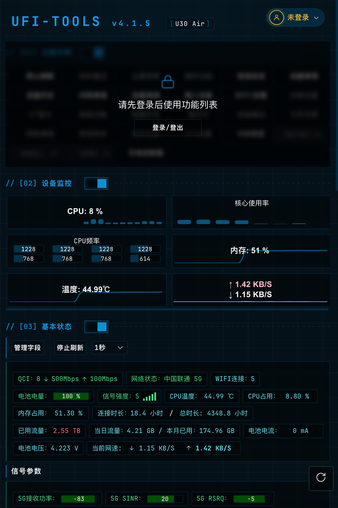
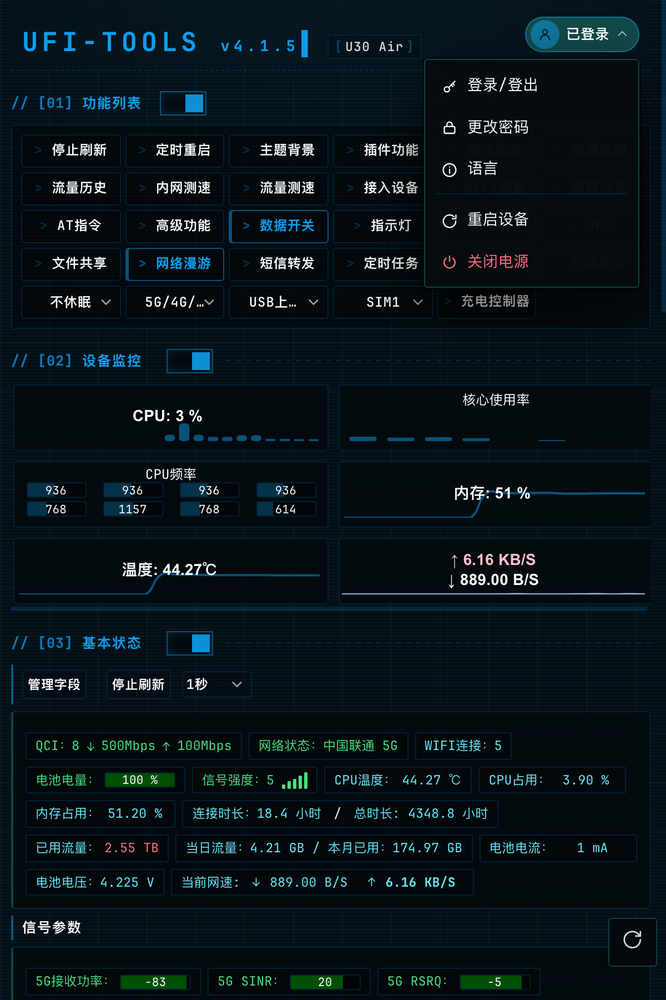
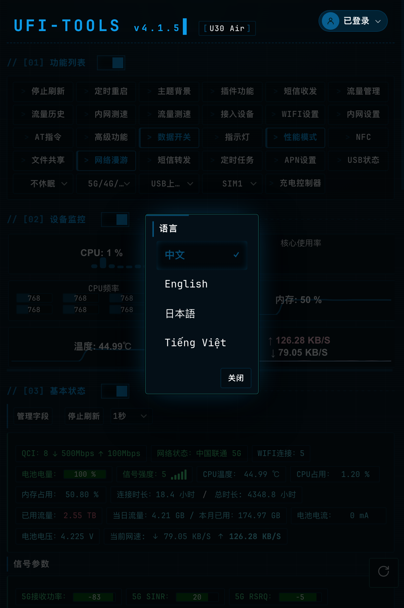
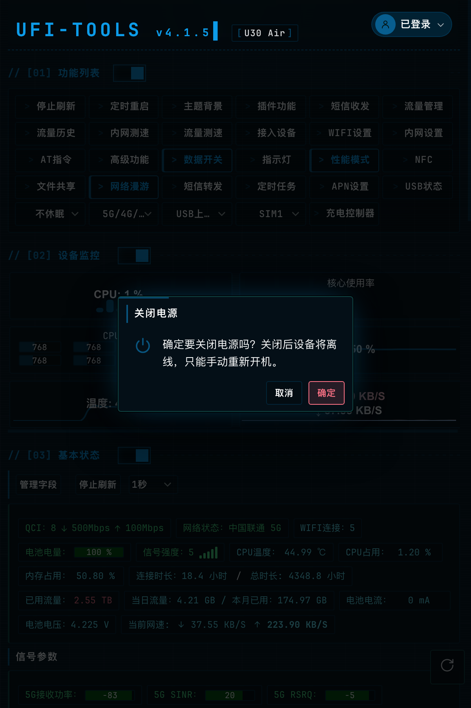

# UFI-TOOLS 修改说明（相对上游原版）

> 本仓库基于开源项目 **UFI-TOOLS** 修改而来，**非官方版本**。
> 所有原始代码、设计与商标均归原作者所有，本仓库仅在其基础上做了界面的调整。

## 上游项目信息

| 项目 | 内容 |
| --- | --- |
| 原仓库 | [kanoqwq/UFI-TOOLS](https://github.com/kanoqwq/UFI-TOOLS) |
| 本版基线分支 | [`http-server-version`](https://github.com/kanoqwq/UFI-TOOLS/tree/http-server-version)（完整版，安装在设备上运行） |
| 作者 | Minikano（[@kanoqwq](https://github.com/kanoqwq)） |
| 开源协议 | MIT License（见 [LICENCE](./LICENCE)，`Copyright (c) [2025] [Minikano]`） |
| 本版基线版本 | UFI-TOOLS **v4.1.5**（适配 U30 Air / F50 等中兴紫光平台设备） |

---

## 修改概览

| # | 类型 | 修改内容 |
| --- | --- | --- |
| 1 | 移除 | 去掉左上角标题里的「开发者菜单」彩蛋（`#TTYDModal`） |
| 2 | 调整 | 功能列表改为**登录后才可用**（未登录显示遮罩） |
| 3 | 新增 | **右上角用户菜单**：登录/登出、更改密码、语言、重启设备、关闭电源 |
| 4 | 调整 | 语言切换由 `<select>` 下拉框改为**弹窗**选择 |
| 5 | 调整 | 「重启 / 关闭电源」从功能列表迁入用户菜单，确认方式改为**弹窗确认** |
| 6 | 修复 | 流量历史数据严重偏小（只有几百 KB） |
| 7 | 修复 | `/api/root_shell` 在未开高级功能时误报「请检查命令输入格式」并返回 500 |
| 8 | 修复 | 顶栏 `width:100%` 造成的横向溢出、用户菜单弹层半透明看不清 |

涉及文件：

```
app/frontEnd/public/index.html          页面结构（顶栏、用户菜单、登录遮罩、语言弹窗、电源确认弹窗）
app/frontEnd/public/script/main.js      登录门禁、用户菜单、电源操作、改密入口
app/frontEnd/public/script/i18n.js      语言切换改弹窗
app/frontEnd/public/script/icons.js     新增 user / chevron / power / restart 等图标
app/frontEnd/public/style/style.css     顶栏、用户菜单、遮罩、弹窗按钮样式
app/frontEnd/public/lang/{zh,en,ja,vi}.json  新增文案 key
app/src/main/java/.../MainActivity.kt               流量统计权限自动授权
app/src/main/assets/shell/ufi_keep_alive.sh         保活时自愈流量统计权限
app/src/main/java/.../advanced/advancedToolsModule.kt  root_shell 错误码与文案
```

---

## 详细说明

### 1. 移除「开发者菜单」

原来点击左上角 `UFI-TOOLS` 标题会触发一个隐藏的「开发者菜单」（`#TTYDModal` 弹窗）。本次将整个弹窗及其专属逻辑一并删除（`enableTTYD`、`handleTTYDFormSubmit`、`changeResServer`、`initResServer`、`OP`、`resetTTYDPort`），标题恢复为纯展示。

设备上已有的 TTYD 终端探测逻辑未改动，不受影响。

### 2. 功能列表登录门禁

未登录时，`[01] 功能列表` 区域被一层磨砂遮罩覆盖，提示「请先登录后使用功能列表」并提供登录按钮；点击遮罩上的按钮等同「登录/登出」。

遮罩只覆盖**功能列表**，`[02] 设备监控`、`[03] 基本状态` 等只读信息仍然可见。遮罩层级低于各类弹窗，不会挡住登录框。

### 3. 右上角用户菜单

新增顶栏右侧用户按钮（圆形头像 + 状态文字 + 箭头），按登录状态配色：未登录为琥珀色描边提示，已登录为主题色实心。展开后包含：

- 登录/登出
- 更改密码（中兴 WEB 管理密码）
- 语言
- ——分隔线——
- 重启设备
- 关闭电源（红色，仅检测到电池的机型显示）

原功能列表里的「登录/登出」「更改密码」按钮以及内嵌的语言下拉框已移除。未登录时「更改密码」项自动隐藏。

### 4. 语言切换改为弹窗

`<select id="LANG">` 下拉框改为 `#langModal` 弹窗：列出 中文 / English / 日本語 / Tiếng Việt，当前语言带 ✓ 高亮，底部「关闭」。选择后立即生效并记住偏好。

### 5. 电源操作迁入用户菜单

- 功能列表中的「重启设备」「关机」按钮删除（「定时重启」保留）。
- 用户菜单新增「重启设备」「关闭电源」，确认方式由原来的**连点三次**改为**弹窗确认**，弹窗会说明影响：重启会短暂断网；关机后设备离线、需手动重新开机。
- 「关闭电源」仍只在有电池的机型上出现；顺带修掉一个缺陷——以前刷新页面时若不重新登录，这一项会一直不显示。

### 6. 流量历史数据偏小修复

- **现象**：流量历史每天只有几百 KB，与设备实际用量（GB 级）严重不符。
- **原因**：历史数据取自 Android `NetworkStatsManager.querySummary(TYPE_MOBILE, ...)`，而应用缺少「使用情况访问」（`GET_USAGE_STATS`）授权，只能统计到自身流量。
- **修复**：应用启动时若未授权，后台自动授权（优先走已开启的 root shell，其次用内置 adb 执行 `appops set <包名> GET_USAGE_STATS allow`），并在保活脚本中每轮自愈，避免升级后权限被重置。
- **结果**：流量历史恢复为真实的 GB 级统计。

### 7. `/api/root_shell` 错误处理

- **现象**：打开页面时偶发 `POST /api/root_shell` 返回 `{"error":"shell执行出错: 请检查命令输入格式"}`（HTTP 500）。
- **原因**：未开启「高级功能」时 socat 未运行，但它的 socket 文件被保留（`unlink-close=0`），后端只做了「文件是否存在」检查就去连接，连接失败被统一报成了「命令格式错误」。
- **修复**：区分「未开启」与「连不上」，给出准确文案（如「无法连接 root shell（高级功能可能未开启，或 socat 已退出）」），并将这类**预期状态**改为返回 200，避免每次打开页面在控制台刷一条红色 500；真正的错误（JSON 解析失败、命令为空）仍返回 500。

---

## 截图

> 截图取自真机（U30 Air，v4.1.5）。IMEI、ICCID、IMSI、MAC、IPv6、基站等设备标识信息已做模糊处理。

**未登录：功能列表被锁定，只读信息仍可见**



**已登录：右上角用户菜单（登录/登出、更改密码、语言、重启设备、关闭电源）**



**语言切换改为弹窗**



**电源操作改为弹窗确认（关机为危险操作）**



---

## 构建

```bash
# 1) 构建前端（混淆 main.js / requests.js 并拷贝到 app/src/main/assets）
cd app/frontEnd
npm install
npm run build

# 2) 打包 APK（需要 JDK 21 + Android SDK）
cd ../..
./gradlew assembleRelease
# 产物：app/build/outputs/apk/release/UFI-TOOLS_WEB_V4.1.5_<时间戳>.apk
```

安装：`adb install -r UFI-TOOLS_WEB_V4.1.5_<时间戳>.apk`

---

## 声明

- 本项目为个人修改版，**与原作者无关**，请勿据此向原作者反馈问题。
- 原始项目遵循 **MIT License**，本修改同样遵循该协议，并保留原作者署名（`Copyright (c) [2025] [Minikano]`）。
- 修改内容仅涉及界面交互与上述缺陷修复，不改变设备端既有功能的行为语义；请自行评估使用风险。
